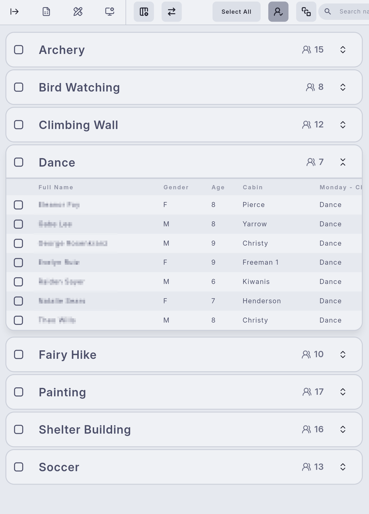
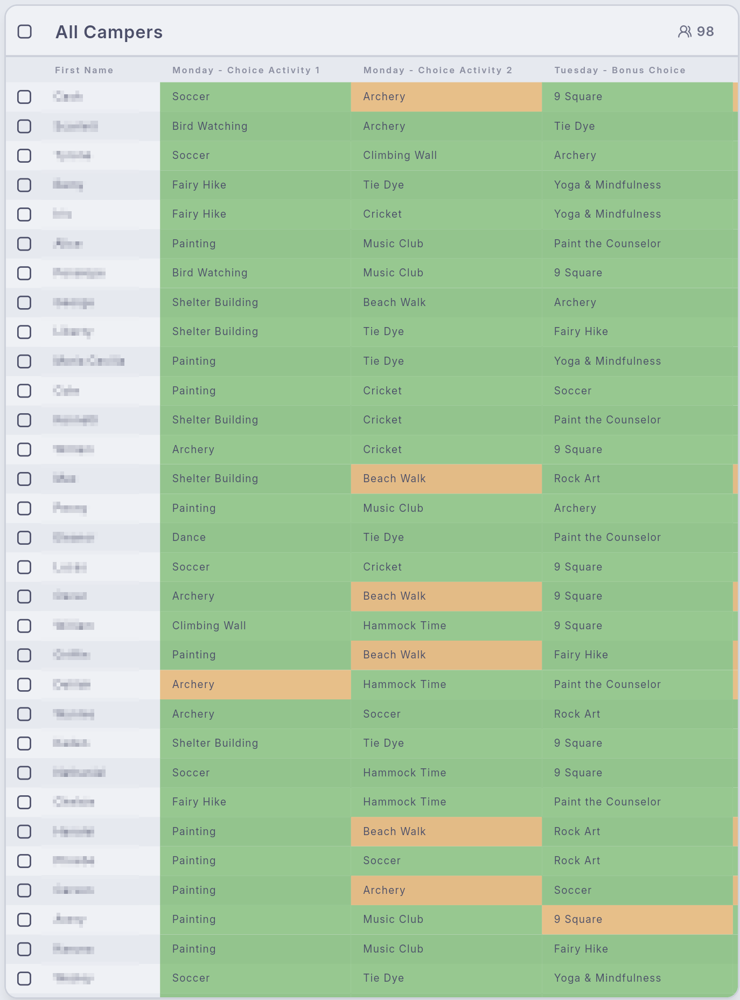
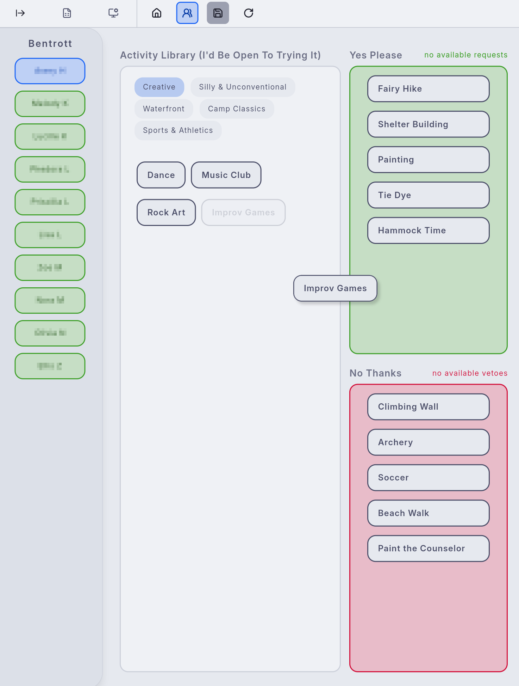

# Bessie

**A cross-platform camp activity scheduling and logistics manager, built with Flutter and Supabase.**

Bessie helps summer-camp staff manage rosters and sessions, collect each camper's activity requests and vetoes, and
assign hundreds of campers to activities every day while respecting capacities, avoiding repetition and honoring as
many wishes as possible.

<p align="left">
  
  
  
</p>

---

## Highlights

- **Constraint-based scheduling engine**: a pluggable pipeline that assigns campers to activities under real-world
  constraints, with two interchangeable strategies, deterministic (seedable) runs and per-step reports.
  ([details](lib/src/algorithms/README.md))
- **A relational backend that enforces the rules**: Postgres schema with foreign keys, constraints, row level
  security and RPCs. A camper can't be double-booked or assigned into another session's schedule, because the
  database says no. ([details](docs/database.md))
- **Live, collaborative roster**: Supabase Realtime pushes changes to everyone working on a session.
- **Desktop-class UI**: responsive layouts, Catppuccin-based theme, an editable roster table and an embedded
  terminal console with typed commands for power users.
- **Cross-platform**: one codebase for web, Windows/macOS/Linux and mobile.

## Features

| Area | What it does |
|---|---|
| **Rosters** | Import UltraCamp CSV exports, search, sort, group and bulk-edit campers; assign them to activities by hand |
| **Activity preferences** | Counselors record each camper's requests and vetoes within the session's limits |
| **Auto-assignment** | Fill the schedule for everyone or a selection, report who couldn't be placed, export an evaluation |
| **Schedule** | A printable weekly view with live enrollment against capacity |
| **Session setup** | Create sessions from the branch's weekly template, register cabins, schedule activities, set limits |
| **Branch catalog** | Manage the activities and cabins a branch offers |
| **Staff & roles** | Director, admin and counselor roles enforced by the database |
| **Console** | Run typed commands against the app from an in-app terminal |

## Quick start (local)

You need the [Flutter SDK](https://docs.flutter.dev/get-started/install) (stable), [Docker](https://docs.docker.com/get-docker/)
and the [Supabase CLI](https://supabase.com/docs/guides/local-development/cli/getting-started).

```bash
# 1. Start the backend: Postgres, Auth, API, Realtime, Studio. Applies the migrations and demo seed.
supabase start

# 2. Run the app against it (port 3000 is what the local auth redirects allow).
flutter pub get
flutter run -d chrome --web-port 3000
```

Sign in with a demo account (password `password123`):

| Account | Role |
|---|---|
| `director@bessie.test` | director: everything, including branches and seasons |
| `admin@bessie.test` | admin: edits session data and the catalog |
| `counselor@bessie.test` | counselor: read-only, can record camper preferences |

The demo data is a camp with two sessions, a weekly template, 29 activities, 8 cabins and about 100 campers, about
two thirds of whom have already chosen preferences, so you can run auto-assignment straight away.

Useful local URLs: Studio (browse and edit data) <http://127.0.0.1:54323>, captured emails (password resets)
<http://127.0.0.1:54324>. `supabase db reset` restores the demo data; `supabase stop` shuts everything down.

### Configuration

The app reads its settings from `--dart-define`s. With none, it targets the local stack.

| Define | Purpose |
|---|---|
| `SUPABASE_URL` | Project URL (default `http://127.0.0.1:54321`) |
| `SUPABASE_ANON_KEY` | The publishable key (safe in a client; row level security protects the data) |
| `SENTRY_DSN` | Optional. Enables error reporting in release builds. No user details are ever sent |
| `SENTRY_ENVIRONMENT`, `RELEASE_VERSION` | Optional Sentry metadata |

## Going to production

1. Create a Supabase project and link it: `supabase link --project-ref <ref>`.
2. Apply the schema: `supabase db push` (or the *Apply database migrations* workflow). The demo seed is
   **local only** and never runs against a hosted project.
3. Create your organization, branch and season, then your staff. Sign-up is disabled; accounts are provisioned with
   the service key:
   ```bash
   SUPABASE_URL=https://<ref>.supabase.co SUPABASE_SERVICE_ROLE_KEY=... \
     scripts/create-staff-user.sh dana@camp.example Dana Director director
   ```
   (Already have a Firestore database? Use [`tools/firestore-migration`](tools/firestore-migration/README.md).)
4. In the Supabase dashboard set the Auth *Site URL* and redirect URLs to where the app is hosted, and configure
   an email provider so password-reset links work.
5. Build with your project's settings:
   ```bash
   flutter build web --release \
     --dart-define=SUPABASE_URL=https://<ref>.supabase.co \
     --dart-define=SUPABASE_ANON_KEY=<publishable key>
   ```
   Pushing to `release/web` does this and publishes to Firebase Hosting (see
   `.github/workflows/release-web-deploy.yml`); any static host works.

## The scheduling engine

`lib/src/algorithms/` is a small framework for solving camper-to-activity assignment as a constraint-satisfaction
problem. It is pure Dart with no I/O, which is why it is thoroughly unit- and property-tested.

- **Pipeline architecture**: an `AlgorithmPipeline` runs an ordered list of `AlgorithmStep`s over a shared state and
  produces an `AssignmentResult` with a timed report for every step.
- **Two strategies**: *diplomatic* (a camper's unfulfilled requests outrank novel activities, which outrank repeats;
  the default) and *greedy scoring*. Both use a lazy-greedy selection loop that re-scores candidates as the schedule fills.
- **Composable constraints**: capacity (including campers outside the run), no adjacent repetition, double-block
  feasibility and per-activity assignment limits.
- **Evaluation**: satisfaction and novelty scores per camper, surfaced in the roster and exportable as CSV.

## Project layout

```
lib/src/
├── app/            startup, dependency wiring, root widget
├── core/           config, logging, error mapping
├── models/         immutable domain objects and row codecs
├── data/           repositories: the only code that talks to Supabase
├── services/       use cases (auth, camp context, auto-assign, CSV import, backups)
├── algorithms/     the scheduling engine (pure Dart)
├── features/       screens and their controllers
├── shared/         shared widgets, theme, constants
├── cli/, commands/ the in-app console
supabase/           migrations, seed, config, database tests
tools/              one-off tooling (Firestore migration)
scripts/            operational scripts
docs/               architecture and database documentation
test/               unit and integration tests
```

See [docs/architecture.md](docs/architecture.md) for how the pieces fit together.

## Development

```bash
flutter analyze
flutter test --exclude-tags integration     # unit tests, no backend needed
flutter test --tags integration             # repositories against the local stack
supabase test db                            # database tests (pgTAP)
dart format .
```

CI (`.github/workflows/ci.yml`) runs all of the above on every pull request.

## Tech stack

- **Framework:** Flutter (Dart 3)
- **Backend:** Supabase: Postgres, Auth, Realtime and PostgREST
- **State / DI:** GetX
- **UI:** shadcn_ui, custom theming (Catppuccin palettes)
- **Monitoring:** Sentry (optional)
- **Exports:** CSV and JSON
